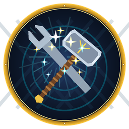

  

<h1 align="center">MassFixStructure 🔨⚡</h1>

  <b>Smart, Zero-Lag Mass Building Repair for Valheim</b> 
  <i>Repair entire connected castles, longhouses, palisades, and naval docks with a single hammer hit — zero stutter, full ward protection, and configurable costs.</i>

  
  
  
  

---

## 🌟 English Description

Tired of clicking hundreds of times to repair roofs, rain-weathered foundations, and post-raid fortresses?
**MassFixStructure** revolutionizes building maintenance in Valheim. Strike a single damaged piece with your hammer to instantly trigger an intelligent repair pulse across your entire contiguous structure or surrounding area.

Engineered with performance, multiplayer safety, and immersion as top priorities:
- **Zero-Lag BFS Traversal:** High-performance, non-allocating Breadth-First Search detects contiguous building components without freezing the client.
- **Frame-Budgeted Coroutine Batching:** When repairing mega-structures (500+ pieces), operations are automatically staggered across frames to prevent server RPC flood, packet drops, or frame drops.
- **Audio & Visual Comfort:** Replaces hundreds of deafening simultaneous sound cues with a smooth, throttled audio chime and subtle repair sparks.
- **Ward & PrivateArea Protection:** Strictly respects Valheim's ward security (`PrivateArea.CheckAccess`). Strangers cannot abuse repairs inside protected territory.
- **Balanced or Free Economy:** Configurable tool durability and stamina consumption ratios — play vanilla-balanced or instant-creative.

---

### 🎮 How to Use

1. Equip your standard **Hammer** (or any building tool with repair capability).
2. Switch to **Repair Mode** (hammer icon).
3. Aim at any damaged piece belonging to your building and hit **Left Mouse Button**.
4. Watch the entire contiguous building or radius restore to 100% health in a wave of golden sparks!

---

### ⚙️ Configuration Options

The config file is located at `BepInEx/config/com.unclebug.massfixstructure.cfg` and can be edited live or via Configuration Manager (`F1`):

| Section | Setting | Default | Description |
|---|---|---|---|
| **General** | `Enabled` | `true` | Master toggle for the mod. |
| **General** | `RepairMode` | `Connected` | Modes: `Connected` (contiguous pieces only), `Radius` (sphere search), or `Hybrid` (both). |
| **Search** | `MaxPieces` | `500` | Maximum number of pieces repaired in a single pulse (safety limit). |
| **Search** | `SearchRadius` | `25.0` | Search radius in meters (for Radius/Hybrid modes or BFS spatial bounds). |
| **Performance** | `StaggerBatchesOverFrames` | `true` | Spreads repair RPCs across consecutive frames to prevent FPS drops. |
| **Performance** | `PiecesPerFrame` | `35` | How many pieces to repair per physics frame when staggered. |
| **Economy** | `DurabilityDrainRatio` | `1.0` | Multiplier for hammer durability consumption (`0.0` = free repair, `1.0` = vanilla 1:1 cost). |
| **Economy** | `StaminaDrainRatio` | `0.0` | Stamina cost ratio per repaired piece (`0.0` = default zero extra drain). |
| **Safety** | `RequireWardAccess` | `true` | Enforces player ward permission check before repairing. |
| **Audio** | `AudioThrottleMode` | `Single` | Audio feedback: `Single` (1 clean sound), `Clustered` (occasional chimes), or `Vanilla` (all). |

---

## 🇷🇺 Описание на русском

Устали тратить минуты и сотни кликов молотком, чтобы починить прохудившуюся крышу, намокшие от дождя балки или замок после набега троллей?
**MassFixStructure** — передовой мод для Valheim, автоматизирующий починку построек. Достаточно ударить молотком по одной поврежденной детали, и волна восстановления плавно и мгновенно починит все соединенные элементы здания или конструкции в радиусе!

### 🚀 Главные преимущества:
- **Умный алгоритм BFS (поиск в ширину):** Находит физически соприкасающиеся и привязанные друг к другу детали одного дома/замка без подвисаний и лишних аллокаций памяти.
- **Пофреймовый батчинг (Coroutine Staggering):** При починке огромных баз (500+ элементов) операции распределяются по кадрам. Никаких лагов, просадок FPS и перегрузки сервера сетевыми пакетами!
- **Защита от оглушающего звука (Sound Throttling):** Вместо 300 наложившихся друг на друга оглушительных ударов воспроизводится один приятный, чистый звук починки.
- **Безопасность оберегов (Ward Protection):** Полная интеграция с охранными кольями (`PrivateArea`). Не позволяет чинить чужие постройки без доступа к оберегу.
- **Гибкая экономика:** Можно настроить расход прочности молотка и выносливости (от ванильного расхода до полностью бесплатного для строителей).

---

### 🛠️ Установка

1. Установите [BepInExPack Valheim](https://thunderstore.io/c/valheim/p/denikson/BepInExPack_Valheim/).
2. Распакуйте архив `MassFixStructure_v1.0.0.zip` в папку `Valheim/BepInEx/plugins/` (или установите через Thunderstore Mod Manager / r2modman в 1 клик).
3. Запустите игру!

---

## 🔒 Zero-Risk & Compatibility Guarantee

- **Client & Server Friendly:** Works seamlessly in singleplayer and on dedicated multiplayer servers.
- **Zero Save-File Pollution:** Does not alter ZDO structures, save formats, or add custom prefabs. Completely safe to install or remove at any point without damaging your world saves!
